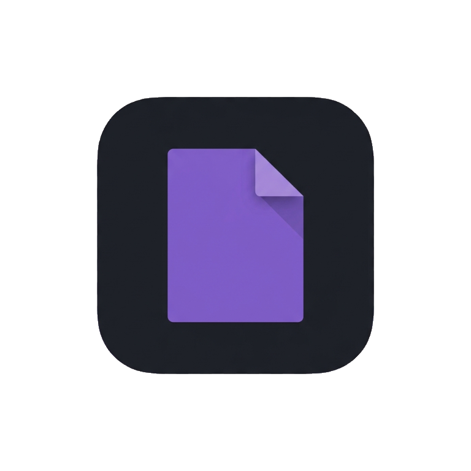

  
  <h1>ClaPDF Android Viewer</h1>
  
<strong>A MuPDF Android viewer with additional features.</strong>

  
Dark mode, text selection and copy, TXT, CSV, ODT, DOCX and XLSX support, and additional scrolling modes.

  

    <strong>Supported devices:</strong> Android phones and tablets running Android 5.0 or later.
  

  

    <a href="https://github.com/GeneralizedAbstractNonsense/clapdf-android-viewer/actions/workflows/build.yml">Download the universal APK</a>
    ·
    <a href="https://github.com/ArtifexSoftware/mupdf-android-viewer">Official MuPDF Android Viewer repository</a>
  

  
In the latest successful build, download the <code>app-debug-apks</code> artifact and select <code>app-universal-debug.apk</code>.

